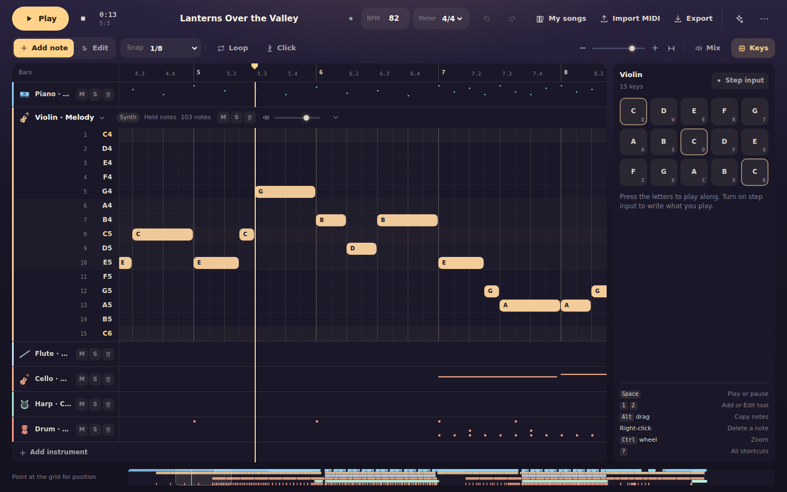

# Sky Music Studio

Write, arrange and play music for the instruments in *Sky: Children of the Light*, right in your browser.

Sky's instruments aren't pianos. Each has a fixed set of keys, and some notes ring out on their own while others can be held. Sky Music Studio is built around those rules, so what you compose stays on keys the instrument really has.



> **Unofficial fan project.** Sky: Children of the Light is a trademark of thatgamecompany. This project is not affiliated with or endorsed by thatgamecompany. It includes original synthesis and user-supplied game sound packs; see `THIRD_PARTY_NOTICES.md` for the distinction between the code and audio.

## Features

**Compose**
- Click to place notes, drag to move them, and box-select to edit many at once.
- Copy, paste, duplicate, quantize and undo, with a shortcut for almost everything.
- Play the on-screen keys, or use `Q`–`T`, `A`–`G` and `Z`–`B` on your keyboard.
- Turn on step input to write what you play, or record over the song as it plays.
- Hear each note as you place or move it.

**Arrange**
- Build a song from up to 24 tracks and 20,000 notes.
- Choose from 44 catalogued instruments and variants.
- Set mute, solo, volume and color for each track.
- Loop any region, and play from wherever you place the cursor.
- Zoom around the pointer, fit the whole song on screen, or jump around with the overview.

**Stay true to the game**
- Only keys the instrument has are available: 15, 8 or 4, with no extra octaves or chromatic notes.
- Notes are stored as physical keys, and pitch comes from the instrument.
- Only instruments that can sustain get held notes.

**Keep your work**
- Songs save automatically in your browser. There's no account or server.
- Import MIDI files, which are arranged onto real game keys.
- Export MIDI and `.skymusic.json` project files. MIDI exported here imports back note for note.
- Optionally load sound packs made from your own recordings. They stay in your browser.
- Versioned sound packs in `public/sound-packs/` load automatically in both dev and production preview, including after a fresh clone.

## Quick start

You need [Node.js](https://nodejs.org/) 20.19 or newer.

```bash
git clone https://github.com/Th1nhNg0/sky-song.git
cd sky-song
npm install
npm run dev
```

Open <http://127.0.0.1:5173> and choose **Play the demo** or **Start a new song**. Your browser unlocks sound the first time you press Play.

The editor is designed for desktop browsers, in windows 1024 px wide or larger.

## Keyboard shortcuts

| Key | Action |
| --- | --- |
| `Space` | Play or pause from the cursor |
| `Shift` + `Space` | Stop |
| `Q`–`T`, `A`–`G`, `Z`–`B` | Play the keys while the key panel is open |
| `1` / `2` | Add note / Edit tool |
| `K` | Show or hide the keys |
| `I` | Step input |
| `L` / `M` | Loop / metronome |
| Arrow keys | Move selected notes, or the cursor |
| `0` | Fit the whole song |
| `Ctrl` + `Z` / `Ctrl` + `Shift` + `Z` | Undo / redo |
| `Ctrl` + `C` / `V` / `D` | Copy / paste / duplicate |
| `?` | Show every shortcut |

With the mouse, `Alt`-drag copies notes, right-click deletes a note, and `Ctrl` + wheel zooms.

## Convert a MIDI file from the command line

```bash
npm run midi2sky -- path/to/song.mid
```

This writes `song.skymusic.json` next to the MIDI file, ready to import. Run `node scripts/midi2sky.mjs -h` for all options. Please only use music you wrote or have the rights to.

## Development

```bash
npm run dev        # start the dev server
npm run verify     # lint, typecheck, unit tests and production build
npm run test:e2e   # browser tests (first run: npx playwright install chromium)
```

`npm run build` creates a static site in `dist/` that works on any static host, from a domain root or a subfolder. It needs no server, environment variables or API keys.

Production is deployed on Cloudflare Workers at <https://sky.thinhcorner.com>.
Cloudflare builds pushes to `main` from `Th1nhNg0/sky-song` with `npm run build`
and deploys with `npx wrangler deploy`. The build splits oversized sound packs
into smaller assets to fit Cloudflare's file limit, preserving every sample.
Local dev and production preview load the same complete packs.

To publish an update, commit your changes and run `git push origin HEAD:main`.
Cloudflare then builds and deploys `main` automatically. Other branches get
separate preview deployments.

The app uses React, TypeScript, Zustand and the Web Audio API:

| Folder | Contents |
| --- | --- |
| `src/music/` | Instruments, pitch, MIDI import, project format and validation |
| `src/audio/` | Synth voices, mixer, playback scheduling and MIDI export |
| `src/state/` | Editor state, playback control and keyboard shortcuts |
| `src/components/` | The interface |
| `src/storage/` | Song library and preferences |
| `tests/` | Unit and browser tests |
| `docs/` | Research, decisions and guides |

## Documentation

- [User guide](docs/user-guide.md)
- [Known gaps and limitations](docs/known-gaps.md)
- [Sky mechanics research](docs/sky-mechanics.md)
- [Project file format](docs/project-format.md)
- [Architecture decisions](docs/decisions.md)
- [Audio sources and licenses](docs/audio-sources.md)

Some instrument details come from community sources. The app and [the research notes](docs/sky-mechanics.md) mark which facts are verified, community-reported or inferred.

## License

The code and documentation are released under the [MIT License](LICENSE). Third-party libraries are listed in [THIRD_PARTY_NOTICES.md](THIRD_PARTY_NOTICES.md).
